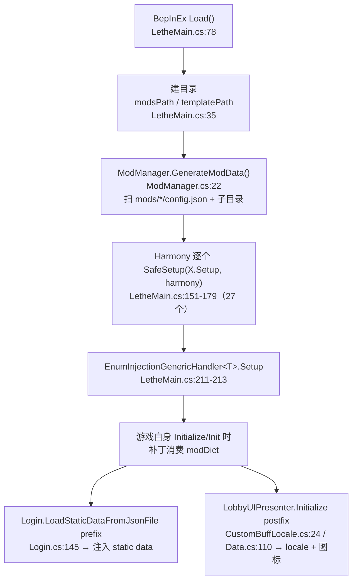

# 计划 02：注册层（Registration Layer）设计

> 状态：**计划文档，不含任何源码改动**。
> 目标：参照 `Lethe.dll` 反编译产物与 `LetheOfficialSupport` 的真实用法，为 LimbusPy 设计一套
> 内容注册基类 + 时点过滤 DSL + 批处理能力，使模组作者能声明式地注册 **Buff / 被动 / 人格 / 技能 / EGO**，
> 并把「条件判断」的跨进程往返压到 **0**。
>
> 阅读顺序建议：§0 结论 → §3 现状诊断 → §4.4 过滤 DSL（本文核心）→ §5 实施清单。

---

## 0. 结论摘要

| # | 结论 | 依据 |
|---|---|---|
| C1 | **Lethe 没有代码级注册 API**。它的"注册"= 往 `BepInEx/plugins/Lethe/mods/<mod>/` 丢声明式 JSON 内容包，由 `ModManager.GenerateModData()` 扫描、由一串 Harmony 补丁消费。作者**不写 C#**。 | `Lethe.Utils/ModManager.cs:22`、`Lethe.Utils/ModData.cs:7` |
| C2 | **Lethe 没有"被动"这个概念**。`Lethe.Passives/` 整个命名空间只有一个 11 行空壳 `ChangeAppearance_Passive.Setup(Harmony) {}`。被动只能作为 static data 注入（dataClass `"passive"`）后由 `BattleUnitModel.AddPassive(int)` 按 id 施加，**触发逻辑无法用 Lethe 声明**。 | `Lethe.Passives/ChangeAppearance_Passive.cs:1-11` |
| C3 | Lethe 的"条件"是**游戏自己的数据**：`AbilityData.scriptName` 的字符串前缀（`ChangeSkillOnConditional_<id>` / `EvadeThenUseSkill_<id>`）配 `AbilityData.buffData{keyword,stack,turn,limit}`。唯一代码级条件抽象是 `Lethe.Utils.RuleCheck(string,string,Func<BattleUnitModel,bool>,EncounterPunishment)`，**C# lambda，mod 作者用不了**（要重编译）。 | `Lethe.SkillAbility/ChangeSkillOnConditional.cs:15-46`、`Lethe.Utils/RuleCheck.cs:20` |
| C4 | 自定义 Buff 的落地是**三件事的组合**，不是"注入一条 `BuffStaticData`"：枚举注入 + static data 行 + 图标/locale 补丁。 | §2.3 |
| C5 | LimbusPy 现在**注册不了被动、注册不了 Buff**，且带条件的时点回调只能手写 `if`，每个 buff 判断 1 次 OPCALL。 | §3 |
| C6 | LimbusPy 当前**只有 5 个 A 层时点有发射方**（`HookTable.Shape`）。`@hook("OnSucceedAttack")` / `@hook("OnGainBuff")` 这些 Modular 名在内核里没有任何 `EmitEvent` 调用方——**它们在真机上不会触发**。注册层必须先补时点，否则 Passive 无处挂载。 | §3.6 |
| C7 | 设计选型：**声明式对象谓词（非 lambda）+ 注册期分配 buff 位图（bitmask）+ payload 预置字段**，让"只在该受击者拥有该 Buff 时触发"变成**一次整数位与**，跨进程往返 0。 | §4.4 / §4.5 |
| C8 | 实现选型：**类定义即声明、loader 收集即注册**（不搞 import 副作用），注册动作收敛到新生命周期 `on_ready()`（HELLO 之后、首个事件之前）一次性 `content.plan`。 | §4.3 / §4.7 |

---

## 1. 调研对象与方法

### 1.1 事实来源

| 来源 | 路径 | 用途 |
|---|---|---|
| Lethe 反编译（分命名空间） | `<工作区>/analysis/lethe-dll-decompiled/decomp/` | 主证据 |
| Lethe 合并版 | `<工作区>/analysis/lethe-dll-decompiled/Lethe.decompiled.cs` | 交叉验证（grep 定位后读局部） |
| Lethe 配置面 | `<工作区>/LetheLauncher-Distribution-7/BepInEx/config/Lethe.cfg` | 反推功能边界：**只有 2 个 section、`[General]` 11 项 + `[LaunchSettings]` 1 项**，无任何"内容注册"配置项 |
| 真实模组 | `<工作区>/mods/LetheOfficialSupport/` | 作者视角第一手证据 |
| 另一注册风格对照 | `<工作区>/ModularLimbis/ModularSkillScripts/` | Acquirer/Consequence（Lua 驱动） |
| LimbusPy | 本仓库根 | 现状诊断 |

### 1.2 对任务书前提的三处修正（重要）

调研发现任务书的三个假设与代码不符，后面所有设计都按修正后的事实来：

**修正 1：`Lethe.Passives\` 不是"本次最重要的参照"——它几乎是空的。**

```
decomp\Lethe.Passives\  (整个命名空间 1 个文件，185 字节)
  ChangeAppearance_Passive.cs
    internal class ChangeAppearance_Passive : MonoBehaviour {
        public static void Setup(Harmony harmony) { }   // 空函数体
    }
```

对照 `decomp\Lethe\Patches\` 有 34 个文件（`CustomChapters.cs` 20KB、`Texture.cs` 20KB、
`CustomUptie.cs` 13KB ……）。**Lethe 的投入在"内容包 + UI/资产补丁"，不在被动框架。**

**修正 2：`LetheOfficialSupport` 不是"使用 Lethe API 的模组"，而是"中和 Lethe 的守护模组"。**

它的 16 个 `.cs` / 2862 行里，对 Lethe 的调用**只有一处**，而且是反射：

`mods\LetheOfficialSupport\ContentLoader.cs:195-206`
```csharp
var lethe = LetheRuntimeGuard.LetheAssembly;
if (lethe == null) { GuardLog.Warn(...); return; }
var mm = lethe.GetType("Lethe.Utils.ModManager")
          ?? lethe.GetTypes().FirstOrDefault(t => t.Name == "ModManager");
var gen = mm.GetMethods(BindingFlags.Public | BindingFlags.NonPublic | BindingFlags.Static)
            .FirstOrDefault(m => m.Name == "GenerateModData");
...
gen.Invoke(null, args);   // ← 唯一一次"调用 Lethe API"
```

其余全是**关掉 Lethe 的功能**（`LetheRuntimeGuard.cs:68-85`）：
```csharp
Ret("Lethe.Patches.Http", "Setup", "A http-rewrite");
Ret("Lethe.Patches.Login", "Setup", "A auth-forgery + static-data upload");
Ret("Lethe.Patches.Server", "Setup", "A jwt-ticket + auto-unlock");
Iterator("Lethe.LetheHooks", "LoginCoroutine", "A login coroutine");
...
```
然后**自己重写** Lethe 的内容加载（`ContentLoader.PreLoad` 直接往 `StringStaticDataJson._textList` 追加
JSON、`SkillInitOverride` 做 `TryAdd` 去重）。

**这个事实本身就是最强的设计证据**：当一个"框架"没有公开 API 时，下游模组只能
`GetType("...") + GetMethods().FirstOrDefault(m => m.Name == "...")` 去反射它、并且为了绕开它的
网络/认证副作用而整体接管它的加载流程。**LimbusPy 的注册层必须给出稳定的、有签名的、
不依赖字符串约定的公开 API**，否则三年后会有另一个 `LimbusPyOfficialSupport` 来把我们的
`LimberPy.Patches.XXX.Setup` 逐个 `Ret(...)` 掉。

**修正 3：LimbusPy 的 B 层 Modular 时机名目前没有发射方。**

`@hook("OnSucceedAttack")`（`examples/sinking_tide/__init__.py:219`）、
`@hook("OnGainBuff", keyword=SINKING)`（同文件 `:239`）、
`@hook("ChangeTakeDamage", sync=True)`（同文件 `:247`）在内核里**一个都不会触发**：
全仓唯一的事件发射点是 `LimbusPy.Ops/HookTable.cs:74-105`（`Capture` → `_queue` → `Tick` → `host.EmitEvent`），
而 `HookTable.Shape()` 的 `switch` 只认 `DamageDealt / AttackSucceeded / UnitDied / UnitBroken / TurnStarted`
（`HookTable.cs:125-178`）。`grep -r "EmitEvent"` 只命中该文件与 `KernelHost.cs:500`。

→ **注册层不能建在"已经有 30 个 Modular 时机"的假设上。P0 必须先补时点。**

---

## 2. 参照对象一：Lethe 的公开 API 与注册模型

### 2.1 公开 API 长什么样：没有 API，只有目录约定

**命名空间**：`Lethe`（插件根）、`Lethe.Patches`（34 文件）、`Lethe.Utils`、`Lethe.EnumInjections`、
`Lethe.SkillAbility`、`Lethe.Motions`、`Lethe.Sounds`、`Lethe.VisualMods`、`Lethe.Passives`（空壳）。

**插件入口**（`decomp\Lethe\LetheMain.cs:20-22`）：
```csharp
[BepInPlugin("Lethe", "Lethe", "1.2.07")]
public class LetheMain : BasePlugin
{
    public const string GUID = "Lethe";
    public override void Load() { ... }      // LetheMain.cs:78
}
```

**加载生命周期（谁扫描 / 谁实例化 / 何时注入）**：



关键点：**没有"实例化作者的类"这一步**。作者的东西是一堆 JSON，`ModData`（反序列化目标）
里没有一个字段是行为，全是元数据：

`decomp\Lethe.Utils\ModData.cs:7-37`
```csharp
public class ModData {
    [JsonProperty("modID")]            public int id;
    [JsonProperty("modName")]          public string trueModName;
    [JsonProperty("excludedFilesList")]public HashSet<string> excludedFiles;
    [JsonProperty("dependenciesList")] public HashSet<string> modDependencies;
    [JsonProperty("modVersion")]       public float modVersion;
    [JsonProperty("bonusNodes")]       public Dictionary<string, JObject> bonusNodes;
    [JsonIgnore] public string modName = "";
    [JsonIgnore] public int isDisabled = 0;                  // 由目录名前缀决定
    [JsonIgnore] public Dictionary<string, List<string>> modFilesPathByName;
}
```
`isDisabled` 是靠**目录名**来的（`ModData.cs:39-58`）：`DISABLED_xxx` → 1，`FULLDISABLED_xxx` → 2。
**连"启用/禁用"都是文件系统约定。**

`ModManager.GenerateModData` 认的 section（`ModManager.cs:83-149`）：

| 目录名 | 内容形态 | 消费者 |
|---|---|---|
| `custom_limbus_data/<dataClass>/` | `.json` / `.lua` | `Patches/Login.cs:145` 注入 static data |
| `custom_limbus_locale/<lang>/<table>/` | `.json` / `.lua` | `Patches/Data.cs:35` 注入 `TextDataSet._*` |
| `custom_buffs` / `custom_panics` / `custom_unit_keywords` | **文件名即枚举成员名** | `EnumInjectionGenericHandler<T>` |
| `custom_encounters` / `custom_stories` / `custom_chapters` | 目录（`encounter.json`+`subchapterui.json`） | `Patches/Encounters.cs:110` |
| `custom_sprites` / `custom_appearance` | `.png`/`.mp4` / `.bundle` | `Patches/Texture.cs` |
| `custom_sounds` | `Audio.json` | `Sounds/CustomSoundManager.cs` |

### 2.2 它怎么表达「被动」

**结论：表达不了。** 三层证据：

1. `Lethe.Passives\ChangeAppearance_Passive.cs` 是空实现（`Setup` 函数体为空，连 `[HarmonyPatch]` 都没有）。
2. `decomp\Lethe\` 全域 grep `PassiveData|PassiveDetail|AddPassive|PassiveAbility` → **0 命中**；
   `Lethe.decompiled.cs` 全域只命中 1 行：`[HarmonyPatch(typeof(PassiveDetail), "OnPartBreaked")]`
   （这是 `Patches/Skills.cs` 的改动外观补丁，不是被动框架）。
3. 被动只能当**静态数据**注入：`custom_limbus_data/passive/*.json`，走 `Patches/Login.cs:145` 的
   `PreLoadStaticDataFromJsonFile` prefix → `AddCustomData()` 塞进 `StringStaticDataJson._textList`
   （`Login.cs:213-245`），然后 `SkillStaticDataList.Init` / `PassiveStaticDataList.Init` 解析它。
   `LetheOfficialSupport` 的 `ContentLoader._domains`（`ContentLoader.cs:122-126`）明确列了
   `{ "passive", Domain.Passive }`。

**触发时机的声明方式**：不存在。被动一旦作为数据被加载，行为完全由游戏自己的
`PassiveData.abilityScriptList` 决定；作者想加新行为只能写 `scriptName` 前缀约定的字符串，
指望某个 Harmony 补丁恰好认识这个前缀。

**条件如何表达**：同上——要么是游戏数据，要么是 C# lambda（见 §2.5）。

### 2.3 它怎么注册 Buff：三件事的组合

这是本次调研最需要精确的地方。**不是"注入一条 `BuffStaticData`"**，而是三条互相独立、
各自在不同时机生效的路径：

#### (1) 枚举成员注入 —— 让 `BUFF_UNIQUE_KEYWORD` 认得你的名字

`decomp\Lethe\LetheMain.cs:211`
```csharp
EnumInjectionGenericHandler<BUFF_UNIQUE_KEYWORD>.Setup(new Lethe.EnumInjections.CustomBuffs());
```

`decomp\Lethe.EnumInjections\CustomBuffs.cs:5-17`
```csharp
public class CustomBuffs : EnumInjectionGenericHandler<BUFF_UNIQUE_KEYWORD> {
    public override string dataPath => "custom_buffs";          // ← 目录名
    public static BUFF_UNIQUE_KEYWORD ParseBuffUniqueKeyword(string keyword,
        BUFF_UNIQUE_KEYWORD fallbackType = BUFF_UNIQUE_KEYWORD.Enhancement) {
        if (!Enum.TryParse<BUFF_UNIQUE_KEYWORD>(keyword, ignoreCase: true, out var result)) {
            LetheMain.customLogs.LogError("Invalid status: " + keyword);
            return fallbackType;
        }
        return result;
    }
}
```

`decomp\Lethe.EnumInjections\EnumInjectionGenericHandler.cs:35-128`（id 分配算法，**这段必须抄下来当反例**）：
```csharp
int num  = 4096;   // 基址
int num2 = 0;      // 偏移
int num3 = 2;      // 步长
for (int j = 0; j < list.Count && list[j] != null; j++) {
    string text = list[j];
    if (j > 63 && j < 72) { list2.Add(list[j]); text = "placeholdervalue_" + j; }  // 64..71 被保留
    int num4 = 1 + num + num2;                    // → 4097, 4099, 4101 ...
    dictionary.Add(text, num4);
    num2 += num3;
}
EnumInjector.InjectEnumValues<T>(dictionary);      // ← 真正改 il2cpp 枚举元数据
```
配额与截断（同文件 `:49-75`）：
- `list.Count > 90` → `list.RemoveRange(90, list.Count - 90)`（**静默截断**，只 LogWarning）
- `64 < list.Count < 90` → 补 `placeholdervalue_N` 到 90 条（"to avoid possible problematic overrides"）

→ **硬结论**：Lethe 把 `BUFF_UNIQUE_KEYWORD` 的 `4097 + 2k` 号段**当自己的领地**了。
LimbusPy 若也要注入，必须换基址（§4.6 / §6.4）。

#### (2) 图标 —— Harmony prefix 直接返回自定义 Sprite

`decomp\Lethe.Patches\Texture.cs:244-283`
```csharp
[HarmonyPatch(typeof(UISpriteDataManager), "GetBufSprite")]
[HarmonyPrefix]
private static bool GetBufSprite(BUFF_UNIQUE_KEYWORD type, ref Sprite __result) {
    string text = Il2CppType.Of<BUFF_UNIQUE_KEYWORD>().GetEnumNames()[(int)type];
    Sprite sprite = LoadSpriteFromFile("buffIcon_" + text);
    if (sprite == null) return true;      // 没图 → 放行原方法
    __result = sprite; return false;      // 有图 → 吞掉原方法
}

[HarmonyPatch(typeof(BuffStaticData), "GetBuffIconSprite")]
[HarmonyPrefix]
private static bool GetBuffIconSprite(BuffStaticData __instance, ref Sprite __result) {
    Sprite sprite = LoadSpriteFromFile("buffIcon_" + __instance.GetBuffIconID());
    if (sprite == null) return true;
    __result = sprite; return false;
}

[HarmonyPatch(typeof(BuffStaticData), "GetBuffTypoIconSprite")]
[HarmonyPrefix]
private static bool GetBuffTypoIconSprite(BuffStaticData __instance, ref Sprite __result) { /* 同上 */ }
```

图源：`custom_sprites/buffIcon_<name>.png`，**强制 128×128**（`Patches/CustomBuffLocale.cs:44-56` 用
`RenderTexture` + `ReadPixels` 缩放）。

另有一条字体图集路径 `Patches/CustomBuffLocale.cs:24-130`：把 63 张 128×128 打成 1024×1024
`TMP_SpriteAsset` 塞进 `TMP_Settings.defaultSpriteAsset.fallbackSpriteAssets`。
（注意 `:101` 的 `Texture2D texture2D4 = list[0];` 是**原版 bug**：循环里没取 `list[k]`，
每一格都贴同一张图。我们不要复制这个错误。）

#### (3) 本地化 —— 改 `TextDataSet` 的字典

`decomp\Lethe.Patches\Data.cs:35-58`（通用注入器）+ `:60-108`（42 张 locale 表清单）：
```csharp
public static void LoadCustomLocale<T>(string name, JsonDataList<T> list)
    where T : LocalizeTextData, new() {
    foreach (string item in ModManager.GetPathFilesByName("custom_locale_" + name)) {
        JSONNode jSONNode = JSONNode.Parse(File.ReadAllText(item));
        foreach (var item2 in jSONNode) {
            T value = JsonUtility.FromJson<T>(item2.value.ToString(2)) ?? throw ...;
            list._dic[item2.key] = value;          // ← 直接改游戏单例的字典
        }
    }
}
```
Buff 相关的是 `LoadCustomLocale("bufList", instance._bufList)`（`:70`）与
`LoadCustomLocale("bufffAbilityList", instance._buffAbilityList)`（`:102`，注意三个 f 是原版拼写）。

#### (4) Buff 效果文本必须靠 static data

`LetheOfficialSupport\ContentLoader.cs:74-78` 的注释是一手证据：
```csharp
// Inject custom data for EVERY dataClass (that was Login.PreLoad's behavior);
// the guard domain below only controls which ids get REGISTERED for filtering.
// Skipping injection for untracked classes broke custom buffs (buff static data
// never entered the tables -> effect text unregistered).
```
→ **只注入枚举 + 图标是不够的**：Buff 的层数上限/回合上限/效果描述来自 static data 行，
不注入就是"有名无实"的可施加 buff。

### 2.4 它怎么注册人格 / 技能 / EGO

**统一机制：往游戏的 static data JSON 流里插行。** 没有专门的"人格 API"。

`decomp\Lethe.Patches\Login.cs:145-211`
```csharp
[HarmonyPatch(typeof(StaticDataManager), "LoadStaticDataFromJsonFile")]
[HarmonyPrefix]
private static void PreLoadStaticDataFromJsonFile(IStaticDataJson staticDataJson) {
    string dataClass = staticDataJson.GetDataClass();               // "personality" / "ego" / "skill" / "passive" / ...
    bool append = (dataClass == "personality" || dataClass == "ego");// ← 只有这两类是追加
    foreach (string item in ModManager.GetPathFilesByName("custom_data_" + dataClass)) {
        JSONNode jSONNode = JSONNode.Parse(File.ReadAllText(item));
        AddCustomData(staticDataJson, jSONNode, append);
    }
    // 之后还把 jSONArray 上传到 https://api.lethelc.site/custom/upload/<dataClass>（:187-198）
}
```
`Login.cs:213-245`
```csharp
private static void AddCustomData(IStaticDataJson staticDataJson, JSONNode node, bool append) {
    var s = staticDataJson.TryCast<StringStaticDataJson>();
    if (s != null) { if (append) s._textList.Add(item); else s._textList.Insert(0, item); return; }
    var l = staticDataJson.TryCast<LegacyStaticDataJson>();
    if (l != null) { if (append) l._nodeList.Add(node); else l._nodeList.Insert(0, node); }
    else LetheMain.customLogs.LogError("Unknown static data source for " + ...);
}
```

**插入顺序是语义的一部分**：非 personality/ego 类用 `Insert(0)` → **后加载的 mod 排在前面**、
在 `dict.TryAdd` 去重里**先赢**；personality/ego 用 `Add` → 排后面。

**技能还额外接管了 `Init`**（`Login.cs:247-270`），改成 `TryAdd` 好让 mod **覆盖官方 skill id**：
```csharp
[HarmonyPatch(typeof(SkillStaticDataList), "Init")]
[HarmonyPrefix]
private static bool override_load_skill_data(IStaticDataJson staticDataJson, SkillStaticDataList __instance) {
    __instance.list = new List<SkillStaticData>();
    __instance.dict.Clear();
    for (int i = 0; i < staticDataJson.GetCount(); i++) {
        var list = JsonUtility.FromJson<SkillStaticDataList>(staticDataJson.GetDataByIndex(i))?.GetList();
        for (int j = 0; j < list.Count; j++)
            if (__instance.dict.TryAdd(list[j].ID, list[j])) __instance.list.Add(list[j]);   // first-wins
    }
    return false;   // 跳过原版 Init
}
```

**"必填字段" = 游戏自己的 `XxxStaticData` 反序列化契约**，Lethe 完全透传（漏字段就是默认值或 null）。
Lethe 自己的办法是**模板 JSON + 改字段**，见 `Patches/Encounters.cs:173-183`：
```csharp
private static SubChapterData GenerateSubchapterData(SubchapterUIDataInPart subchapterUIData) {
    string json = "{ \"id\": 0, \"illustSprName\": \"107\", ... \"nextMainchapterid\": 101, ... }";
    SubChapterData subChapterData = JsonUtility.FromJson<SubChapterData>(json);
    subChapterData.id = subchapterUIData.nodeId;                   // 只覆盖必要字段
    var firstElement = subChapterData.stageNodeList.GetFirstElement();
    firstElement.nodeId  = subchapterUIData.nodeId;
    firstElement.stageId = subchapterUIData.nodeId;
    return subChapterData;
}
```
和章节/遭遇的 `subchapterList.Insert(0, subChapterData)`（`Encounters.cs:134-135`）。

### 2.5 它怎么做「只在某条件下触发」

**主要答案：条件 = 数据。** 代码只负责**认识一个字符串前缀**。

`decomp\Lethe.SkillAbility\ChangeSkillOnConditional.cs`（全文 48 行，是本主题唯一的完整样本）：
```csharp
internal class ChangeSkillOnConditional {
    internal static string lookupSkillAbilityName = "ChangeSkillOnConditional_";     // :8

    [HarmonyPatch(typeof(BattleUnitModel), "OnStartTurn_BeforeLog")]
    [HarmonyPostfix]
    private static void StartTurn_BeforeLog(BattleActionModel action, BattleUnitModel __instance) {
        foreach (AbilityData item in action._skill.GetSkillAbilityScript()) {       // :19 遍历技能的能力脚本槽
            string scriptName = item.scriptName;
            if (!scriptName.StartsWith(lookupSkillAbilityName)) continue;           // :22 前缀即开关
            if (item.buffData == null) continue;
            int skillID = Convert.ToInt32(scriptName.Substring(lookupSkillAbilityName.Length)); // :33 尾部即参数
            string buffKeyword = item.buffData.buffKeyword;                         // :34 条件数据
            if (!Enum.TryParse<BUFF_UNIQUE_KEYWORD>(buffKeyword, out var result)) continue;
            int stack = item.buffData.stack;                                        // :40
            int turn  = item.buffData.turn;                                         // :41
            if (__instance.GetActivatedBuffStack(result) >= stack
             && __instance.GetActivatedBuffTurn(result)  >= turn)                   // :42 ← 唯一一处条件判断
                action.TryChangeSkill(skillID);
        }
    }
}
```
同款第二个样本 `NewEvadeThenUseSkill.cs:38-101`（前缀 `EvadeThenUseSkill_`，`OnSucceedEvade` postfix，
用 `item.buffData.limit` 做次数上限，且用两个 `Dictionary<int,...>` 在 `StageController.StartRound`
postfix 里清零做**按回合重置**——这就是 Lethe 版的 `once_per_turn`）。

**次要答案：条件 = C# lambda**，但只对自己人开放。`decomp\Lethe.Utils\RuleCheck.cs:20`
```csharp
public RuleCheck(string name, string description,
                 Func<BattleUnitModel, bool> isViolation,
                 EncounterPunishment defaultPunishment)
```
用法在 `LetheMain.cs:226-230`：
```csharp
EncounterRules.Register("91911", new int[2]{91911,9191101}, true, true,
    new RuleCheck("ExtremeStats", "Health/shield >= 10000 or speed >= 1000.",
        (BattleUnitModel u) => u.GetCurrentHp() >= 10000 || u.GetShield() >= 10000 || u.GetIntegerOfOriginSpeed() >= 1000,
        EncounterPunishment.CrashGame),
    new RuleCheck("OverLimit", "Health/shield above 600 + 5*level, or speed >= 50.",
        u => { int n = 600 + (int)u.Level * 5; return u.GetCurrentHp() > n || u.GetShield() > n || u.GetIntegerOfOriginSpeed() >= 50; },
        EncounterPunishment.KillUnit));
```
→ 这是"条件即代码"的**反面教材**：只有能改 `Lethe.dll` 源码的人才能加条件。

### 2.6 失败模式与限制

| 维度 | Lethe 的做法 | 对我们的含义 |
|---|---|---|
| 补丁失败 | `LetheMain.SafeSetup(Action<Harmony>, harmony, name)`（`LetheMain.cs:256-268`）**逐个 try/catch**，只 `LogError`。**该功能静默缺席，插件继续跑**。 | 我们要抄这个：单个内容包坏掉不能拖垮整个注册层 |
| 错误上报 | `LetheCustomDebug` + `LetheMain.LogError/LogWarning/LogFatalError` 三个静态 `Action<string>`；等级由 `Lethe.cfg:LogLevel`（0/1/2） | 我们有 `Mod.log` + kernel `LOG` 消息，够用；需要**结构化**到 `stats()` |
| 必须重启 | **枚举注入、static data 注入**（只在 `LoadStaticDataFromJsonFile` 一次）；图标/locale 在 `LobbyUIPresenter.Initialize`（每次回大厅） | 我们的 Buff/Passive `define` 同理 → 必须设计成"改 Buff 定义 = 重启游戏"并在文档里明说 |
| 半热重载 | `LetheHooks.Update` 里按 `Alpha8`（`LetheMain.cs:146`）→ `ModManager.GenerateModData()` + `StaticDataManager._isDataLoaded=false` + `LoadUserDataAndSetScene(SCENE_STATE.Main)` + `Data.LoadCustomLocale`（`LetheHooks.cs:50-56`）——**等于重开一局** | 我们的 `on_ready()` 可以做得更好：不用重开，因为 op 是按需调用 |
| ID 冲突 | `EnumInjectionGenericHandler<T>.Setup` 是 **`if (Instance == null)` 单例**（`:26-33`）→ **只有第一个 Setup 生效**，第二个 mod 的内容被静默丢弃；基址 4096 固定 → 与任何别的注入器撞车 | 我们的注入必须**追加式**（读现状再 Append），且基址要可配 |
| 与其他 mod 冲突 | `SkillStaticDataList.Init` 整体接管 + first-wins；多个 mod 都改同一 skill id 时**顺序决定一切**（`Insert(0)` → 后装的赢） | 我们要有**冲突报告**（`content.plan` 返回 conflicts 列表），而不是靠顺序 |
| 官方一致性 | `:187-198` 把自定义内容**上传到私有服务器**，服务器端参与校验 | LimbusPy 是纯本地，无此问题；但**反过来**：我们的注入内容如果进了官方存档/云同步字段，风险要我们承担（§6.1） |

### 2.7 `LetheOfficialSupport`：作者写了多少、调了什么、最常写的模式

- **规模**：16 个 `.cs`，**2862 行**（`Sanitizer.cs` 654、`Domains.cs` 369、`OutboundGuard.cs` 348、
  `MiniJson.cs` 243、`ContentLoader.cs` 198、`LocalOwnership.cs` 191、`StandInMap.cs` 151、
  `LetheRuntimeGuard.cs` 144、`LosBridge.cs` 139、`Plugin.cs` 106 …）。
  另有 `mlctest/Program.cs`（44 行）只做一件事：`asm.GetType("Lethe.Utils.ModManager")` 是否为 null。
- **调了哪几个 Lethe API**：**一个都没有**（见修正 2）。它对 Lethe 的全部依赖是：
  1. `LetheRuntimeGuard.LetheAssembly`（反射拿 `Assembly`）
  2. `"Lethe.Utils.ModManager"` 字符串 + `GenerateModData` 反射调用
  3. 一批 `"Lethe.Patches.*.Setup"` / `"Lethe.LetheHooks.StartBrowser"` 字符串，用来**返回早**（`Ret`）
- **最常写的模式**（按出现次数）：
  1. `AccessTools.Method(type, "Name")` + `harmony.Patch(m, prefix/postfix: new HarmonyMethod(...))` —— 出现在
     `ContentLoader`(3处)、`LocalOwnership`(2)、`OutboundGuard`(2)、`FormationSync`、`MirrorDungeonSync`(3)、
     `BattleLogGuard`、`TransportGuard`，**7 个文件 13 处**
  2. `Try { ... } catch { GuardLog.Warn(...) }` —— 防御式包裹，几乎每个方法
  3. JSON 里"挖 id"（`ContentLoader.ExtractIds:138-159`，递归找 `id`/`ID` 数字字段）
  4. 用 `Domain` 枚举 + `HashSet<int>` 手工维护"哪些 id 是官方的 / 哪些是我们注入的"
     （`Domains.cs:8-31`）——**为了区分"官方内容"和"模组内容"而写的一整套账本**

→ **对我们最有价值的启示**：`Domains.cs` 那 369 行存在的原因，正是 Lethe 没有给出
"这东西是谁注册的"这个信息。**LimbusPy 的注册层必须在 API 层面就回答 `owner` 是谁**
（`Content.uid = "<mod>.<kind>.<local_id>"`），并把它一路带到内核侧的账本里。

---

## 3. 参照对象二：LimbusPy 现状诊断

### 3.1 没有"被动"这个概念

现状只有两个东西：**时点回调** 和 **按 id 施加一个已存在的数据行**。

`ops/spec/api.toml:163-173`
```toml
[[op]]
name = "unit.add_passive"
class = "UnitOps"
method = "add_passive"
summary = "按被动 id 施加一个被动（最安全的"施加效果"入口）。"
args = [ { name = "unit", type = "unit" }, { name = "passive_id", type = "int", doc = "PassiveData 的 id" } ]
returns = "bool"
```
`kernel/LimbusPy.Ops/UnitOps.cs:109-117`
```csharp
public object AddPassive(Dictionary<string, object> args) {
    var unit = OpsArgs.Unit(args);
    var passiveId = OpsArgs.Int(args, "passive_id", 0);
    if (passiveId <= 0) return false;
    unit.AddPassive(passiveId);          // ← 一个整数进去，什么都不能声明
    return true;
}
```
`PassiveData` 必须**已经存在**（官方表里的，或者别的 mod 注入的）。
作者**无法**说"我这个被动在 AttackSucceeded 且目标有 SINKING 时打 8 点"。

### 3.2 时点回调没有条件过滤，作者只能自己写 if

过滤器的**全部**能力（`python/limbuspy/mod/decorators.py:63-75`）：
```python
filters = {}
if heads is not None:  filters["head"] = bool(heads); ...
if tails is not None:  filters["tail"] = bool(tails); ...
if crit  is not None:  filters["crit"] = bool(crit)
if keyword is not None: filters["keyword"] = keyword
```
求值（`python/limbuspy/mod/registry.py:41-59`）：
```python
def matches(self, event: dict) -> bool:
    if event.get("timing") != self.timing: return False
    for key, expected in self.filters.items():
        if expected is None: continue
        actual = event.get(key)
        if key == "keyword":
            keywords = actual if isinstance(actual, (list, tuple)) else [actual]
            if expected not in keywords: return False
        elif bool(actual) != bool(expected): return False
    return True
```
→ **只能比对"事件 payload 里已经有的标量字段"**。`victim.has("buff")`、`round >= 3`、
`damage > 100`、`once_per_turn` 一个都表达不了，只能进函数体写 `if`：

`python/examples/sinking_tide/__init__.py:316-339`（作者的现状）
```python
def _evaluate(self, ctx, book, attacker_uid: str) -> Optional[dict]:
    candidates = [unit for unit in book.enemy_units if not unit.data.get("is_dead")]
    scored = []
    for unit in candidates:
        stacks = unit.buff_stack(SINKING)          # ← 每个敌人 1 次往返（:325）
        scored.append((stacks, -unit.hp_ratio, unit))
    scored.sort(key=lambda item: (item[0], item[1]), reverse=True)
    best_stacks, neg_ratio, best = scored[0]
    if best_stacks < int(self.cfg.threshold): return None
    if -neg_ratio > float(self.cfg.hp_ratio_ceiling): return None
    round_ = int(book.round)
    if self.cfg.once_per_round and self.last_burst_round == round_: return None
    return self._burst(ctx, best, best_stacks, book)
```
三个条件全是手写 `if` + 自己维护 `last_burst_round` 做 `once_per_round`。

### 3.3 没有 Buff 注册/定义能力

13 个 op 里与 buff 有关的是：`unit.buff_stacks` / `unit.buff_turns` / `unit.buffs`（读）、
`unit.burst_by_buff`（按层数打伤害）、`unit.add_buff`（**experimental**）。

`ops/spec/api.toml:196-215`
```toml
[[op]]
name = "unit.add_buff"
stability = "experimental"        # ← 明确标注未真机验证
doc = """**实验性**：真实时序（activeRound、history 列表）在真机上需要验证；失败时返回 False 而不是抛错。"""
```
`kernel/LimbusPy.Ops/UnitOps.cs:159-183`（整段 try/catch，失败返回 false）
```csharp
public object AddBuff(Dictionary<string, object> args) {
    var keyword = OpsArgs.EnumValue(args, "keyword", default(BUFF_UNIQUE_KEYWORD));
    ...
    try {
        var detail = unit._buffDetail;
        if (detail == null) return false;
        int addedStack, addedTurn, overStack, overTurn;
        var applied = detail.AddBuff(unit, keyword, null, 0, ABILITY_SOURCE_TYPE.PASSIVE, timing,
                                     null, out addedStack, out addedTurn, out overStack, out overTurn, true);
        return applied;
    } catch { return false; }
}
```
两个硬约束：
- `keyword` 走 `OpsArgs.EnumValue`（`OpsArgs.cs:103-112`）→ **`Enum.TryParse<BUFF_UNIQUE_KEYWORD>`**。
  运行期用 `EnumInjector` 注入的成员能不能被 `TryParse` 认到，**没有验证过**；
  认不到就抛 `LpcpFault.Marshal("argument 'keyword' is not a member of BUFF_UNIQUE_KEYWORD")`。
- 只能施加**游戏已有**的 buff（`BuffStaticData` 里得有这一行，否则 `BuffDetail.AddBuff` 找不到模型）。

### 3.4 每次判断 buff 都要一次跨进程往返

`python/limbuspy/api/ops.py:73-83` → `kernel/LimbusPy.Ops/UnitOps.cs:19-24`：
```python
def buff_stacks(self, unit, keyword) -> int:
    return self._session.op('unit.buff_stacks', {...})       # 1 次 OPCALL
```
```csharp
public object BuffStacks(Dictionary<string, object> args) {
    var keyword = OpsArgs.EnumValue(args, "keyword", default(BUFF_UNIQUE_KEYWORD));
    return (long)OpsArgs.SafeInt(() => unit.GetActivatedBuffStack(keyword, false));
}
```
一次 OPCALL = 一次命名管道往返 + 一次 `MainThreadDispatcher` 排到游戏主线程。
**代价不只是延迟，而是帧边界**——`docs/05-typed-api.md:105-108` 已经把这点写清楚了：
> 如果拆成 Python 的多步，中间会被帧边界/其它事件插进来，读到的是旧层数、打到的是旧血量。

最糟的读法是 `unit.has_keyword` 循环，或 `sinking_tide:325` 那样**每个敌人一次**。

### 3.5 `Mod` 子类 + `state` + `cfg` + `_patches`：作者要理解多少

`python/limbuspy/mod/base.py:24-46`
```python
class Mod:
    name: str = ""; version: str = "0.0.0"; description: str = ""; author: str = ""
    requires: List[str] = []
    cfg: Optional[ConfigSpec] = None
    def __init__(self) -> None:
        self.state: Dict[str, Any] = {}
        self.bridge = None; self.logger = None
        self._patches: List[str] = []        # ← 作者不该关心
        self._session = None; self._ops_session = None; self._ops_facade = None
```
作者要同时理解 6 件事，而且**四套"状态"含义不同**：

| 机制 | 位置 | 含义 | 坑 |
|---|---|---|---|
| `self.state` | `base.py:38` | 任意字典，整体持久化 | 和 `ctx.state` 不同生命周期 |
| `self.cfg` | `base.py:35` + `decorators.py:139-207` | 带默认值/校验/choices 的配置 | 只有 `ConfigSpec` 才被 `_restore_state` 认（`runtime.py:282-283`） |
| `ctx.state` | `context.py:36` + `runtime.py:396` | **每个 hook 私有**，跨热重载保留 | key 是 `entry.name`（函数名），改名就丢 |
| `self._patches` | `base.py:42` | 框架记账，卸载时自动摘 | **作者不该碰** |
| `on_save/on_restore` | `base.py:55-60` | 与 `self.state` 二选一还是叠加？ | 都在 `_save_state`（`runtime.py:256-277`）里被合进同一个 dict |
| `registry` generation | `registry.py:99-124` | 迟到回包不会打到新代码 | 引用（句柄）不跨重载（`docs/02-mod-authoring.md:206`） |

`sinking_tide` 用了 430 行才把这些串起来（`__init__.py:132-190`）。**这不是作者该付出的理解成本。**

### 3.6 症状量化（这是注册层要消灭的数字）

| 场景 | 现状代价 | 证据 |
|---|---|---|
| 「受击者身上有 SINKING 吗」 | 1 次 OPCALL（`unit.buff_stacks`） | `api/ops.py:73` |
| 「受击者有 SINKING 或 COMBUSTION 吗」 | 2 次 OPCALL（或 1 次 `unit.buffs` + Python 筛选） | `api/ops.py:95-102` |
| 「全场谁有 SINKING」 | N 次 OPCALL（N = 敌人数） | `sinking_tide:324-327` |
| 「受击者 HP / 是否 break / 站位」 | 1 次（`unit.info`，6 字段）——已是极限，再拆成 3 次 | `api.toml:26-40` |
| 「现在第几回合」 | 1 次 OPCALL（`battle.round`） | `api.toml:102-107` |
| `once_per_turn` / `cooldown(2)` / `chance(0.3)` | 作者自己写，通常**配一次往返去读回合** | `sinking_tide:335-337` |
| 「注册一个被动」 | **做不到** | §3.1 |
| 「注册一个自定义 Buff」 | **做不到**（只能 `add_buff` 游戏已有的） | §3.3 |
| 「B 层 Modular 时点（`OnGainBuff` 等）」 | **不会触发**（无发射方） | §1.2 修正 3 |

---

## 4. 目标设计

### 4.1 设计约束

1. **不能要求作者写的代码比 Lethe 的 JSON 内容包更啰嗦**（Lethe 作者只丢 JSON 就能加 buff）。
   → 我们的目标形态是「一个类 + 一个装饰器」。
2. **不能打破 A 层"可独立失效"**：`kernel/LimbusPy.Bridge.Core/Ops/OpsApi.cs:15` 的 `IOpsProvider`
   是跨程序集契约，`LimbusPy.Ops.dll` 是按需 `Assembly.Load` 的（`Bridge/Runtime/OpsLoader.cs`）。
   → **新增能力优先做成 op**（走已有的 `Invoke` 路由），不轻易加接口方法。
3. **过滤条件必须零往返**，否则等于把 `if` 从函数体挪到了装饰器里，白干。
4. **热重载必须继续成立**：注册是 generation 感知的，不能有 import 副作用。
5. **不碰源码即可渐进**：P0 能独立发布。

### 4.2 基类清单与取舍

| 基类 | P 阶段 | 理由 |
|---|---|---|
| `Content`（元数据根） | P0 | 所有内容的公共面 |
| `Buff` | **P0** | 用户明确要求的场景；也是 bitmask 机制的载体 |
| `Passive` | **P0** | 作者最想写的东西；实现上是 `Content` + 一组 `@on`，成本极低 |
| `Identity`（人格） | **P3** | 落地 = static data 注入 + 一堆 UI 补丁（Lethe 花了 `CustomUptie.cs`+`CustomUptieStoryHelper.cs` 32KB）；ROI 最低。P3 只做**声明 + 数据校验 + 复用官方模板** |
| `Skill` | **P3** | 同上；且 `SkillStaticDataList.Init` 去重语义要单独验证 |
| `Ego` | **P3** | 同 `Identity`；且 EGO 与人格耦合 |

**取舍结论**：**P0/P1 只做 `Buff` + `Passive`**。`Identity`/`Skill`/`Ego` 在 P0 就**定义出类签名和校验**
（让作者能提前写、提前报错），但 `define()` 在 P3 之前返回 `NotImplemented` 并给出明确降级行为
（只走"复用官方 id"路线）。

#### 4.2.1 `Content`（元数据根）

```python
# python/limbuspy/registration/base.py
class Content:
    """可注册内容的元数据根。子类**在类体里声明**，由 loader 收集，不产生 import 副作用。"""

    kind: ClassVar[str] = ""              # "buff" | "passive" | "identity" | "skill" | "ego"
    local_id: ClassVar[str] = ""          # 必填：mod 内唯一的英文 key
    display: ClassVar[str] = ""           # 必填：显示名（进 locale）
    desc: ClassVar[str] = ""
    game_id: ClassVar[int] = 0            # 非 0 = 复用官方数据行（路线 a）

    # -- 框架填充（只读，勿手写）-----------------------------------------------------
    mod: "Mod" = None                     # type: ignore[assignment]
    uid: str = ""                         # "<mod>.<kind>.<local_id>"
    index: int = -1                       # 内核分配的局部序号（buff 用作 bit 位）

    # -- 生命周期（全部可选重写，默认空实现）-----------------------------------------
    def on_register(self, mod: "Mod") -> None:
        """本地校验后、注入前。可改 `self.to_static_row()` 的结果。0 往返。"""

    def on_ready(self, ctx) -> None:
        """内核已分配 id/bit 之后（`on_ready` 阶段）。**唯一**允许读游戏状态的地方。"""

    def on_battle_start(self, ctx) -> None: ...
    def on_battle_end(self, ctx) -> None: ...

    # -- 数据 ------------------------------------------------------------------------
    def to_static_row(self) -> dict:
        """生成游戏 static data 的一行（`Buff`/`Passive` 子类实现）。0 往返。"""
        return {}

    def validate(self) -> List[str]:
        """返回问题列表（空 = OK）。由 loader 在 `on_register` 前调用，**不抛异常**。"""
        return []
```

#### 4.2.2 `Buff` — 生命周期 + 完整签名

```python
class Buff(Content):
    kind = "buff"

    # -- 必填 ------------------------------------------------------------------------
    local_id: ClassVar[str]
    display:  ClassVar[str]                  # 中文名 → `_bufList` locale
    # -- 选填（默认值来自游戏 BuffData 的真实字段形态）--------------------------------
    key:        ClassVar[str] = ""           # BUFF_UNIQUE_KEYWORD 名；空 = local_id.upper()
    desc:       ClassVar[str] = ""
    buff_type:  ClassVar[str] = "Neutral"    # "Positive" | "Negative" | "Neutral"
    max_stack:  ClassVar[int] = 1
    max_turn:   ClassVar[int] = 1
    icon:       ClassVar[str] = ""           # 相对 mod 目录的 png；空 = 用占位图
    keywords:   ClassVar[tuple[str, ...]] = ()   # 附带的中文关键词

    # -- 字段（读游戏实体的扁平值形态，与 api/types.py:143 BuffInfo 对齐）------------
    # id          : int            内核分配（路线 b）或 == game_id（路线 a）
    # m_buff_type : Literal["a","b"]  路线（"a" 复用官方 / "b" 真注入）

    # -- 生命周期（未重写 = 不订阅，C# 侧零开销）------------------------------------
    def on_attach(self, unit: UnitRef, ctx) -> None:
        """首次被施加到某单位（该单位此前没有此 buff）。"""

    def on_stack(self, unit: UnitRef, old: int, new: int, ctx) -> None:
        """层数变化（含被清除到 0 → 之后紧跟 on_detach）。"""

    def on_turn(self, unit: UnitRef, turns_left: int, ctx) -> None:
        """自己的回合开始、回合数递减后。"""

    def on_detach(self, unit: UnitRef, ctx) -> None:
        """层数/回合归零被移除。"""

    def on_register(self, mod: "Mod") -> None: ...
    def to_static_row(self) -> dict:
        return {"id": self.id, "keyword": self.key, "buffType": self.buff_type,
                "maxStack": self.max_stack, "maxTurn": self.max_turn}
```

**最小可用示例（14 行）**：

```python
# mods/sinking_overload/buffs.py
from limbuspy.registration import Buff

class Drowning(Buff):
    local_id  = "drowning"
    key       = "DROWNING"
    display   = "溺水"
    buff_type = "Negative"
    max_stack = 10
    max_turn  = 3
    icon      = "assets/buffIcon_DROWNING.png"

    def on_attach(self, unit, ctx):
        ctx.log("%s 获得了溺水" % (unit,))
```

#### 4.2.3 `Passive` — 实现上是 "Content + 一组带条件的 `@on`"

```python
class Passive(Content):
    kind = "passive"

    local_id: ClassVar[str]
    display:  ClassVar[str]
    desc:     ClassVar[str] = ""
    cost:     ClassVar[int] = 0
    keywords: ClassVar[tuple[str, ...]] = ()
    owner:    ClassVar[str] = "self"      # "self" | "ally" | "enemy" | "all" —— 施加范围
    priority: ClassVar[int] = 0           # 同一个时点上的执行顺序（大者先）

    # 触发点由 `@on(...)` 声明（见 §4.4），不需要额外的 Trigger 枚举。

    def on_attach(self, unit: UnitRef) -> None: ...
    def on_detach(self, unit: UnitRef) -> None: ...
    def on_battle_start(self, ctx) -> None: ...
    def on_turn_start(self, ctx) -> None: ...

    def to_static_row(self) -> dict:
        return {"id": self.id, "name": self.display, "cost": self.cost}
```

**最小可用示例（19 行，同时就是用户要求的主场景）**：

```python
# mods/sinking_overload/passives.py
from limbuspy.registration import Passive, on, victim, ev, once_per_turn
from .buffs import Drowning

class TideCrush(Passive):
    local_id = "tide_crush"
    display  = "潮汐碾压"
    owner    = "self"

    @on("AttackSucceeded",
        when=victim.has(Drowning) & (ev.hp_damage > 0) & once_per_turn())
    def crush(self, ev, ctx):
        # 走到这里 ⇒ 受击者身上一定有 Drowning；全程 0 次跨进程往返。
        ctx.ops.unit.damage(ev.target, 8)
```

#### 4.2.4 `Identity` / `Skill` / `Ego`（P3，先定签名）

```python
class Identity(Content):
    kind = "identity"
    local_id: ClassVar[str]; display: ClassVar[str]; desc: ClassVar[str] = ""
    character: ClassVar[int] = 0        # 必须对应官方 characterList 的 id
    rarity:    ClassVar[int] = 1        # 1/2/3 → 00/00/0000
    season:    ClassVar[int] = 0
    base_game_id: ClassVar[int] = 0     # **必填其一**：以官方人格为模板（复用其技能表/立绘/音效）
    skills:   ClassVar[tuple[type["Skill"], ...]] = ()
    passives: ClassVar[tuple[type["Passive"], ...]] = ()
    def to_static_row(self) -> dict: ...        # P3

class Skill(Content):
    kind = "skill"
    local_id: ClassVar[str]; display: ClassVar[str]
    base_game_id: ClassVar[int] = 0     # **必填**：模板技能 id（决定动作/特效/音效）
    affinity: ClassVar[str] = ""        # sin 属性名
    defense_type: ClassVar[str] = ""    # "" | "GUARD" | "EVADE" | "COUNTER"
    coin_power: ClassVar[int] = 0
    coin_count: ClassVar[int] = 0
    def to_static_row(self) -> dict: ...        # P3

class Ego(Content):
    kind = "ego"
    local_id: ClassVar[str]; display: ClassVar[str]
    base_game_id: ClassVar[int] = 0     # **必填**
    identity: ClassVar[type[Identity] | None] = None
    def to_static_row(self) -> dict: ...        # P3
```

**为什么 `base_game_id` 是必填**：Lethe 的经验（`Encounters.GenerateSubchapterData`、
`CustomUptie`）说明，**从零造一个人格/技能的数据行必崩**（缺动作、缺立绘、缺音效、缺 UI 绑定）。
唯一可行路径是"拿官方行当模板 + 覆盖少数字段"。我们的 API 应该把这个现实**写进签名**，
而不是让作者踩一遍。

### 4.3 注册方式：类定义即声明，loader 收集即注册

**三个候选**：

| 方案 | 优点 | 致命问题 |
|---|---|---|
| A. metaclass 在类创建时立刻注册 | 零样板 | ① import 副作用 → 模块 import 失败会留半个注册表；② 与 generation 语义冲突（`registry.py:99-124`）；③ 不知道属于哪个 Mod 实例 |
| B. 显式 `mod.register(Drowning)` | 无歧义 | 每个内容一行样板；忘记调用即静默不生效 |
| **C. 类体声明 + loader 收集**（选它） | 无样板、无 import 副作用、generation 天然正确 | 需要 loader 多走一遍 |

**理由**：C 正是现有代码已经确立的原则——`mod/decorators.py:3-5` 的模块 docstring 写得很清楚：

> Declarative on purpose: the loader reads these attributes off the classes/objects it imports, so
> registration never depends on import side effects and a reload can rebuild the whole table from
> source without stale entries.

`register_instance`（`loader.py:296-339`）已经在做这件事（扫 `@hook`/`@expose`）。注册层只是
**在同一趟里多扫一遍 `Content` 子类**。具体实现（`__init_subclass__` 打标记，不注册）：

```python
# registration/base.py
class Content:
    def __init_subclass__(cls, **kw):
        super().__init_subclass__(**kw)
        cls._declared = True                     # 仅打标记，不做任何注册
```

`loader.py` 新增一段（在 `register_instance` 之后、`on_load` 之前调用）：

```python
def collect_contents(instance: "Mod", module, registry: "Registry", gen: int) -> List[Content]:
    """把模块里声明的 Content 子类实例化并绑定到 mod。**不触碰内核**。"""
    out = []
    for attr in dir(module):
        cls = getattr(module, attr)
        if not (isinstance(cls, type) and issubclass(cls, Content) and cls is not Content):
            continue
        if cls.__module__ != module.__name__:      # 只收本模块声明的
            continue
        if getattr(cls, "kind", "") == "":
            continue
        inst = cls()
        inst.mod  = instance
        inst.uid  = "%s.%s.%s" % (instance.name, cls.kind, cls.local_id)
        problems = inst.validate()
        if problems:
            instance.registration_errors.append((inst.uid, problems))
            continue
        instance.contents.append(inst)
        out.append(inst)
    return out
```

**注册到内核的时机**：不在 `on_load`（那时 HELLO 还没交换完，`bridge.hello` 里没有 ops 清单，
`has_op()` 会误判），而在**新的生命周期 `on_ready()`**——`runtime.start()` 里 `handshake()`
之后调用（`runtime.py:136-142` 现在只有 `log`，插一行）：

```python
def start(self) -> dict:
    ...
    hello = self.bridge.handshake(mods=sorted(self.mods), stubs_build=self.stubs_build)
    for name, loaded in self.mods.items():
        self._ready_one(name, loaded)        # ← 新增：content.plan + on_ready()
    self.log(...)
    return hello
```

这样得到三段清晰的时序：

```
import → on_load（本地校验、构建 plan、装 Harmony 补丁）
       → HELLO（拿到 ops 清单 / 能力位）
       → on_ready（一次 content.plan，拿 id/bit 分配；失败降级）
       → 首个事件
```

### 4.4 时点过滤 DSL（本文核心）

#### 4.4.1 为什么不给 lambda

| | lambda | **声明式对象（选它）** |
|---|---|---|
| 静态检查器 | `when=lambda c: ...` 的 `c` 类型难推导，mypy 只能给 `Any` | 每个谓词是**有类型的类**，`victim.has(Drowning)` 的返回类型是 `Pred` |
| C# 侧能否预编译 | 不能（Python 代码过不去） | 能：`to_wire()` 给出结构化描述，C# 可据此算 bit 需求 |
| `needs`/`rpc` 声明 | 不可能 | 谓词自己声明 |
| 热重载 | 闭包持有旧类引用 | 对象持有 `Buff` 类引用（同为旧代际，一起丢弃） |
| 可测试 | 要构造假 `c` | 构造 `Cond` 即可，纯函数 |
| 可打印/可诊断 | `repr` 是内存地址 | `describe()` 返回 `"victim.has('DROWNING') & once_per_turn"` |

代价：`ev.hp_damage` 这种"属性即谓词构造器"的糖需要一点元编程（见 §6.3）。

#### 4.4.2 谓词协议

```python
# python/limbuspy/registration/pred.py
class Pred:
    """可求值、可序列化、可组合的过滤谓词。"""

    __slots__ = ()

    #: 需要哪些上下文通道；"ev" 来自 payload，"victim"/"self" 来自 payload 预置字段+"mask"，
    #: "battle" 表示必须调 op（会打破零往返承诺）。
    needs: ClassVar[frozenset[str]] = frozenset()

    #: 0 = 纯本地；>0 = 需要的 op 次数上限（静态上界）
    rpc: ClassVar[int] = 0

    def __call__(self, c: "Cond") -> bool: ...
    def describe(self) -> str: ...
    def to_wire(self) -> dict:
        """结构化描述，供 C# 侧算 bit 需求 / 生成诊断报告。"""
        return {"op": type(self).__name__, "text": self.describe()}

    # -- 组合（用运算符，DSL 要短）--------------------------------------------------
    def __and__(self, other: "Pred") -> "Pred":  return AllOf(self, other)
    def __or__(self,  other: "Pred") -> "Pred":  return AnyOf(self, other)
    def __invert__(self) -> "Pred":              return Not(self)
    def __bool__(self) -> bool:
        raise TypeError("谓词不能直接当布尔用；请用 & | ~ 组合，或 all_of(...)/any_of(...)")
```

组合子与别名：

```python
class AllOf(Pred):  # needs = 并集, rpc = 和
    def __init__(self, *children: Pred) -> None: ...
class AnyOf(Pred): ...
class Not(Pred):
    def __call__(self, c): return not self.child(c)

all_of   = lambda *ps: AllOf(*ps)        # 具名别名，方便从别的语言迁过来的人
any_of   = lambda *ps: AnyOf(*ps)
none_of  = lambda *ps: Not(AnyOf(*ps))
```

#### 4.4.3 内置谓词清单

| 作者写法 | 类 | needs | rpc | 求值 |
|---|---|---|---|---|
| `victim.has(Drowning)` | `HasBuff(role="victim", bit=n)` | `{victim}` | **0** | `bool(c.mask_victim & (1 << n))` |
| `victim.has_any(Drowning, Burn)` | `HasAnyBuff` | `{victim}` | **0** | `bool(mask & bits)` |
| `victim.stacks(Drowning) >= 3` | `Stacks(role, bit, op, n)` | `{victim}` | **0** | 层数进 `Cond.victim_stacks`（见 §4.5.2） |
| `self_unit.has(Drowning)` | `HasBuff(role="self", ...)` | `{self}` | **0** | 同上 |
| `self_unit.is_break` | `Flag(role="self", field="is_break")` | `{self}` | **0** | `c.self_unit.is_break` |
| `victim.hp_ratio < 0.3` | `Ratio(role="victim", op="<", n=0.3)` | `{victim}` | **0** | 两个预置 int 相除 |
| `ev.hp_damage > 100` | `EvField("hp_damage", ">", 100)` | `{ev}` | **0** | `getattr(c.ev, "hp_damage")` |
| `ev.is_critical` | `EvField("is_critical", "==", True)` | `{ev}` | **0** | 同上 |
| `round >= 3` | `Round(">=", 3)` | `{battle}`→预置 | **0** | `c.round`（payload 里已有） |
| `once_per_turn()` | `OncePerTurn()` | `{state}` | **0** | `c.state["turn"] != c.round` → 写标记 |
| `once_per_round()` | `OncePerRound()` | `{state}` | **0** | 同上（round 粒度） |
| `cooldown(2)` | `Cooldown(turns=2)` | `{state}` | **0** | `c.round - c.state["last"] >= 2` |
| `chance(0.3)` | `Chance(p=0.3)` | `{state}` | **0** | `c.rng.random() < p`（`rng` 派生自 mod 的确定性种子） |
| `on_heads()` / `on_crit()` | `EvField("head",...)` | `{ev}` | **0** | 兼容现有 `@hook(heads=True)` 语义 |
| `victim.has_keyword("SINKING")` | `HasUnitKeyword` | `{victim}` | **0**（若已 watch） | 同一套 bitmask |
| `any_enemy.has(Drowning)` | `AnyUnit("enemy", HasBuff)` | `{battle}` | **1** | **唯一需要往返的谓词**，显式标注 |

**`priority` 不是谓词**，是 `@on(priority=)` 的既有参数（`decorators.py:51`），沿用 `HookEntry.priority`
（`registry.py:20,123`）——排序大者先。

#### 4.4.4 `Cond`：一次事件唯一的求值上下文

```python
# python/limbuspy/registration/cond.py
@dataclass(frozen=True, slots=True)
class Cond:
    """一次事件内、**所有被动共享**的求值上下文。构造一次，N 个谓词复用。"""
    ev: Any                       # A 层 payload（AttackSucceededPayload 等）
    self_unit: Optional[UnitRef]  # 施加者（有 owner 的被动才有）
    victim: Optional[UnitRef]     # 受击者（AttackSucceeded 的 ev.target）
    round: int                    # payload 预置，0 往返
    mask_self: int                # 本 mod 关心的 buff 位图（self）
    mask_victim: int              # 同上（victim）
    stacks_victim: Mapping[int, int]   # 只含"被 stacks() 声明过"的位 → 层数
    state: dict                   # 本 content+方法 的私有可变状态（跨热重载，见 §4.5.4）
    rng: random.Random            # 确定性随机（chance）
    now: float
```

构造点在 `runtime._on_event_batch`（`runtime.py:380-395` 那个循环里），**每个 event 一次**，
而不是每个 hook 一次：

```python
for index, event in enumerate(events):
    cond = None                                    # 惰性：没有 when 的 hook 不付钱
    for entry in self.registry.hooks_for(event.get("timing") or ""):
        if not entry.matches(event):               # 便宜的字段过滤先做
            continue
        if entry.when is not None:
            if cond is None:
                cond = Cond.from_event(event, self._watches(entry.mod))   # ← 一次
            if not entry.when(cond):
                self.counters["hooks_skipped"] += 1
                continue
        ...
```
（这段就是"多个被动共享一次上下文快照"的落地位置。）

#### 4.4.5 作者写起来的样子

```python
# mods/sinking_overload/__init__.py
from limbuspy.mod import Mod
from limbuspy.registration import on, victim, self_unit, ev, round_, \
    once_per_turn, cooldown, chance, any_of
from .buffs import Drowning
from .passives import TideCrush

class SinkingOverload(Mod):
    name = "sinking_overload"
    version = "0.1.0"

    # —— 用户要求的主场景 ——
    # 注册了 Drowning 这个 Buff 之后，只在**受击者拥有 Drowning** 时触发。
    @on("AttackSucceeded",
        when=victim.has(Drowning) & (ev.is_critical == False),
        priority=10)
    def on_drown_hit(self, ev, ctx):
        stacks = ctx.cond.stacks_victim[Drowning.index]     # 层数也在 payload 里 → 0 往返
        ctx.ops.unit.damage(ev.target, 3 * stacks)

    # 多条件 + 组合子 + 节流
    @on("DamageDealt",
        when=any_of(victim.has(Drowning), victim.has_any("COMBUSTION", "BLEED"))
             & (round_() >= 3)
             & cooldown(2)
             & chance(0.3))
    def maybe_chain(self, ev, ctx):
        ...
```

#### 4.4.6 编译/求值后的样子

注册期由 `compile.py` 把上面的声明变成一张**扁平计划表**（`mod.dump_plan()` 可打印）：

```python
Plan(
    uid        = "sinking_overload.attack_succeeded.on_drown_hit",
    owner      = "sinking_overload",          # 谁注册的（Lethe 缺的就是这个）
    content    = None,                        # Mod 级 hook；Passive 时填 uid
    timing     = "AttackSucceeded",
    priority   = 10,
    needs      = frozenset({"ev", "victim"}),
    rpc        = 0,
    watch      = {"victim": 0b1},              # 只要 Drowning 的 bit 0
    watch_stacks = {"victim": 0b1},            # 还要 Drowning 的层数
    payload_fields = ("target", "is_critical"),
    test       = <Compiled>,
)
```

`test` 的等价展开（打印用 `describe()`，运行时用闭包，避免每次走 `__call__` 的多态开销）：

```python
def test(c: Cond) -> bool:
    return (bool(c.mask_victim & 0b1)                      # victim.has(Drowning)
            and (c.ev.is_critical is False)                 # ev.is_critical == False
            and c.stacks_victim.get(0, 0) >= 1)             # 这里示例没写 stacks，仅示意
```

C# 侧看到的是同一份信息的 wire 形式（由 §4.6 的 `content.plan` 传给内核）：

```jsonc
{
  "mod": "sinking_overload",
  "watch": [ {"key": "DROWNING"}, {"key": "COMBUSTION"}, {"key": "BLEED"} ],
  "hooks": [
    { "uid": "sinking_overload.attack_succeeded.on_drown_hit",
      "timing": "AttackSucceeded",
      "needs": ["ev", "victim"],
      "fields": ["target", "is_critical", "round"],
      "mask": {"victim": [0]},
      "stacks": {"victim": [0]} }
  ]
}
```

内核据此**只装配需要的东西**：`AttackSucceeded` 的 postfix 里
`Shape()` 多填 `target_mask / self_mask / target_hp / target_max_hp / target_is_break / self_* / round`
（`HookTable.cs:123-179` 的那个 `switch`）。**没声明 mask 就不算 mask**——这是省 CPU 的关键。

#### 4.4.7 安全阀：`rpc > 0` 的谓词不许偷偷混进来

```python
@on("AttackSucceeded", when=any_enemy.has(Drowning))      # rpc == 1
# → 注册期报错（除非显式 when=..., allow_rpc=True）：
#   PredicateCostError: any_enemy.has() 需要 1 次跨进程调用；时点过滤要求 rpc == 0。
#   改成：在 on_battle_start 里读一次 battle.snapshot() 存进 self.state，
#        谓词改用 self_state(...) 读缓存。
```

理由：这是「看起来零成本实际每次往返」的唯一防线（§6.2）。

### 4.5 减少调用次数的机制（逐条算省了几次）

#### 4.5.1 机制 1：payload 预置常用字段

`AttackSucceededPayload` 现在 7 个字段（`api/hooks.py:34-52`）。新增：

```toml
# ops/spec/api.toml（AttackSucceeded 段）
[[hook]]
timing = "AttackSucceeded"
payload = [
  # ... 现有 7 个不动（向后兼容）...
  { name = "round",           type = "int",  doc = "当前回合数（payload 预置，0 往返）" },
  { name = "self_hp",         type = "int",  doc = "攻击方 HP" },
  { name = "self_max_hp",     type = "int",  doc = "攻击方 MaxHP" },
  { name = "self_is_break",   type = "bool", doc = "攻击方是否崩溃" },
  { name = "target_hp",       type = "int",  doc = "受击方 HP" },
  { name = "target_max_hp",   type = "int",  doc = "受击方 MaxHP" },
  { name = "target_is_break", type = "bool", doc = "受击方是否崩溃" },
  { name = "target_mask",     type = "int",  doc = "受击方 buff 位图（本 mod 声明的位）" },
  { name = "self_mask",       type = "int",  doc = "攻击方 buff 位图（本 mod 声明的位）" },
]
```

**省下的往返**（一次 `AttackSucceeded` 上"想按 3 个条件过滤"的典型写法）：

| 现状写法 | 现状 | 改后 |
|---|---|---|
| `ctx.ops.unit.info(ev.target)` 拿 hp/max_hp/is_break | 1 | 0 |
| `ctx.ops.battle.round()` | 1 | 0 |
| `ctx.ops.unit.info(ev.unit)` | 1 | 0 |
| `ctx.ops.unit.buff_stacks(ev.target, "SINKING")` | 1 | 0 |
| **合计** | **4 次/事件** | **0** |

C# 侧成本：`Shape()` 里多读 8 个字段（`unit.Hp` / `unit.MaxHp` / `unit.IsBreak()`），全是内存读，
在 postfix 里做（`HookTable.cs:74-87` 本来就是 O(1) 攒队列，不碰 Python）。

#### 4.5.2 机制 2：注册期声明"关心的 buff" → C# 维护 bitmask

作者在内容里**天然就声明了**（`Buff` 类本身就在注册表里），所以这一步对作者是**零成本**的：

- `content.plan` 把本 mod 用到的所有 `Buff` 排成 0..63 的位序 → 返回 `{"DROWNING": 0, "COMBUSTION": 1, ...}`
- C# 侧 `MaskTable`：每个 `BattleUnitModel` 一份 `long[]`（或 `Dictionary<instanceId,long>`），
  在**事件发生前**（`HookTable.Capture` 里，同一时间片）算好塞进 payload
- Python 侧 `victim.has(Drowning)` = `mask & (1 << 0)`

**省下的往返**：k 个 buff 判断从 **k 次 OPCALL → 0 次**。`victim.has_any(a,b,c)` 仍是 0。
`victim.stacks(b) >= n` 需要层数 → 位图旁边再带 `stacks`（见下）。

**层数怎么带**：不能把 64 个层数都塞进 payload（体积）。做法是"**只带声明过的**"：
`compile.py` 收集所有 `stacks(...)` 谓词用到的位，plan 里报 `stacks: {"victim": [0, 1]}`，
C# 只填这几个 `int`，放进 payload 的 `target_stacks`（`List[int]`，长度 ≤ 声明数）。
示例里 2 个 → payload 多 2 个 int，**仍是 0 往返**。

**位数上限**：63 位/角色（`long` + 符号位）。超过就在注册期报错，建议作者改用 `unit.buffs()`
一次拿全（1 次/事件）或 `self_state` 缓存。**不要静默截断**（Lethe 的 90 条静默截断是反面教材）。

#### 4.5.3 机制 3：批量 getter `unit.state()` / `battle.chars()`

现状读一个单位的"全貌"要：`unit.info`（1）+ `unit.buffs`（1）+ `has_keyword` × M（M次）。
新 op：

```toml
# ops/spec/registration.toml
[[op]]
name = "unit.state"
class = "UnitOps"
method = "state"
summary = "一次拿全：基础状态 + 全部 buff + 单位关键字 + buff 位图。"
doc = """
替代 `info` + `buffs` + `has_keyword`×M。**一次 crossing 拿 4 类数据**。

`mask` 使用本 mod 在 `content.plan` 里分配的位序；未注册 mod 的位恒为 0。
"""
args = [ { name = "unit", type = "unit" } ]
returns = "UnitState"
returns_doc = "info/buffs/keywords/mask/stacks"
```

| 读法 | 现状 | `unit.state()` |
|---|---|---|
| info（10 字段） | 1 | — |
| buffs（N 条） | 1 | — |
| has_keyword × M | M | — |
| **合计** | **2 + M** | **1** |

`M = 5` 时 **7 → 1**。`battle.chars()` 同理（全场）：`1 + N×(2+M)` → **1**。

#### 4.5.4 机制 4：合并求值（一个事件一个 `Cond`）/ 状态本地化

- 一个 `AttackSucceeded` 上有 M 个注册的被动 → 现状若都"读一次回合+读一次 buff"是 `M×k` 次；
  机制 1+2 后是 **0**；`Cond` 构造只做一次（§4.4.4 代码）。
- `once_per_turn` / `cooldown(2)` / `chance(0.3)` 全在 `Cond.state` 上算，**0 往返**。
  且 `ctx.state` 已被 `_save_state` 持久化（`runtime.py:269-271` 的 `__hooks__`），
  **热重载不丢**——现状是作者自己 `self.last_burst_round` 手写（`sinking_tide:157,335`）。
- 全局快照：`on_battle_start` 里一次 `battle.chars()` 存进 `self.state`，之后谓词用
  `self_state(...)` 读缓存 → 全场级条件 `2N+1 → 1`（每场一次）。

#### 4.5.5 机制 5：注册期一次分配（`content.plan`）

N 个内容如果各自调一次"给我分配 id/bit"就是 N 次往返。改成**一次**：

| | 现状（假想） | 改后 |
|---|---|---|
| 注册 6 个 buff + 4 个被动 | 10 次 OPCALL | **1 次**（`content.plan` 批量） |

#### 4.5.6 总账

| 事件类型 | 现状（典型 mod） | 注册层 | 省 |
|---|---|---|---|
| `AttackSucceeded`（3 条件 + 1 buff 判断 + 回合） | 4 crossing | **0** | 4 |
| `AttackSucceeded`（M=4 个被动各自判断） | ~16 crossing | **0** | 16 |
| 每场战斗开始 | 1 + 2N | **1** | 2N |
| 全场循环判断 | N | **0**（用 mask 一次扫全场） | N |
| 内容注册（6 buff + 4 passive） | 10 | **1** | 9 |
| **热重载一次** | 全部重来 | 同上（plan 重算，**不重开游戏**） | — |

### 4.6 Buff 定义的落地：两条路

#### 路线 (a) 复用游戏已有 buff id + 自定义逻辑

```python
class DeepSinking(Buff):
    local_id = "deep_sinking"
    game_id  = 42                # ← 官方 SINKING（sinking_tide/data/BuffData.json:3 记录 id=42）
    display  = "深溺"            # 不改 locale，只改我们自己的显示
    # 不注入枚举、不注入 static data、不替换图标
    def on_stack(self, unit, old, new, ctx):
        if new >= 6: ctx.ops.unit.damage(unit, 4)
```

- **可行性：高。** 走已实现的 `unit.add_buff`（`UnitOps.cs:159-183`，experimental）。
- **风险**：① 层数/回合上限是官方的，改不了；② 与游戏自身对该 buff 的语义共享同一份数据，
  玩家的 SINKING 会被我们的逻辑同时消费（`sinking_tide` 已经踩这个坑）；③ 与别的 mod 抢同一个 id；
  ④ `add_buff` 的真机时序未验证（`api.toml:204`）。
- **成本**：P0/P1 约 150 行（Python 侧包装 + `game_id` 校验 + 冲突检测）。

#### 路线 (b) 真注入新的 `BuffStaticData` + 新枚举值

必须三件事一起做（§2.3）：枚举注入、static data 行、图标 + locale。少一件的表现：

| 少做 | 症状 |
|---|---|
| 枚举注入 | `unit.add_buff(keyword="DROWNING")` 抛 `marshal`（`OpsArgs.cs:111`） |
| static data 行 | 施加成功但 `GetMaxStack()` 是错的 / 层数暴涨 / 效果文本空 |
| 图标 | 显示空白方框（`GetBuffIconSprite` 回 null） |
| locale | 显示 `buf_name_DROWNING` 这类 key 原文 |

- **可行性：中。** 全部组件在 Lethe 里都验证过（`EnumInjector.InjectEnumValues`、
  `StringStaticDataJson._textList`、`BuffStaticData.GetBuffIconSprite` prefix）。
- **风险**：见 §6.1 / §6.4（id 空间、存档、Lethe 共存）。
- **成本**：P2 约 600 行（C# 400 + Python 200）。

#### 建议

> **先把 (a) 做完整（P0/P1），(b) 放到 P2 且只做"最小三件套"**：
> 枚举 + static data 行 + `GetBuffIconSprite` prefix；**不抄** Lethe 的 TMP 图集那条路
> （`CustomBuffLocale.cs:24-130` 有原版 bug，且收益只有"typo 图标"）。

理由：
1. (a) 立刻能满足"注册一个 Buff 然后在时点时过滤"这个**主场景**——过滤靠 bitmask，与路线无关；
2. (a) 的失败模式是"打不出效果"，(b) 的失败模式是"存档读不出来"；
3. (b) 的 id 分配必须等 §4.7 的 `content.plan` 和§6.4 的基址决定先落地。

### 4.7 与 C# 侧的分工

#### 必须写在 C#（Python 做不到或做了会错）

| 职责 | 位置 | 为什么不能 Python |
|---|---|---|
| Harmony 补丁点（`GetBuffIconSprite` / `GetBuffTypoIconSprite` / `LoadStaticDataFromJsonFile` / `SkillStaticDataList.Init`） | `kernel/LimbusPy.Ops/BuffInject.cs`（新） | IL2CPP 无 JIT，注入方法必须手写（`HookTable.cs:257-260` 的注释已说明） |
| 枚举注入（`EnumInjector.InjectEnumValues`） | 同上 | 必须持有 il2cpp 枚举元数据 |
| static data 行注入（`StringStaticDataJson._textList`） | 同上 | 私有字段 + 必须在 `LoadStaticDataFromJsonFile` prefix 的时间片里 |
| bitmask 维护 + payload 扩展 | `kernel/LimbusPy.Ops/MaskTable.cs`（新）+ `HookTable.cs`（改） | 每个事件都要算，过桥就白费 |
| id/bit 分配 + 冲突检测 | `kernel/LimbusPy.Ops/ContentOps.cs`（新） | 要在游戏进程内读"枚举现状 / 已加载 static data 有哪些 id" |
| 私有成员的读写（`unit._buffDetail`） | 已有 `UnitOps.cs:170` | Python 侧没有句柄语义 |

#### 留在 Python

- **谓词求值与内容生命周期**（`registration/pred.py`、`base.py`）——纯逻辑，改了立刻生效；
- 作者业务逻辑（`ctx.ops.*` 调用）；
- 配置 / 账本 / 持久化（`mod/base.py` 已有）；
- 校验与诊断（`describe()`、`dump_plan()`）——不出进程就能跑单测。

#### `IOpsProvider` 需要新增什么？**最好什么都不加**

`kernel/LimbusPy.Bridge.Core/Ops/OpsApi.cs:15-39` 的 `IOpsProvider` 是跨程序集契约，
`LimbusPy.Ops.dll` 是 `Assembly.Load` 拿的（`OpsApi.cs:8-14` 的注释说明了"可独立失效"的设计）。
**给它加方法 = 强制 Bridge.Core 与 LimbusPy.Ops 同步重编译，等于放弃版本容错。**

所以新增能力**一律做成 op**（走已有的 `Invoke(string op, Dictionary<string,object> args)`）：

```csharp
// kernel/LimbusPy.Ops/OpsEntry.cs（改动：只加 Register 行）
Register("content.plan",     _content.Plan);        // 分配 id/bit + 冲突报告
Register("content.register", _content.Register);    // 真正注入（P2）
Register("content.list",     _content.List);        // 诊断
Register("unit.state",       _units.State);         // 批量 getter
Register("battle.chars",     _battle.Chars);        // 全场批量
Register("buff.row",         _content.BuffRow);     // 读一条 BuffStaticData（校验用）
```

`IOpsProvider` **唯一**值得考虑的新增是一个**非契约的探测**，但我们已经有更好的办法：
`Manifest()` 已经会返回 op 清单（`OpsEntry.cs:80-105`），Python 侧 `Session.has_op()`
（`session.py:186-196`）可以直接问"内核有没有 `content.plan`"——**零接口变更**。

若将来某个动作**必须在事件流开始前**完成（例如 bitmask 位宽要固定），也优先用
`content.plan` 的返回值协商，而不是加接口方法。

#### 时序契约（写进文档，作者可见）

```
on_load()     : 0 往返。本地校验 + 构建 plan + 装 Harmony 补丁
on_ready()    : 1 次 content.plan（拿 id/bit 分配；内核不支持则降级）+ N 次 self.contents[*].on_ready()
每帧          : 0（事件推送）或 1（EVENTBATCH 批量，本来就有）
每个事件      : 0（谓词全本地）；只有显式写 ctx.ops.* 才有 crossing
```

---

## 5. 实现方案

### 5.1 文件级改动清单

> 约定：**新增**文件用 `+`，**改动**用 `~`，**生成物**用 `*`。行数为预估（含 docstring）。

#### Python：注册层（新包）

| 文件 | 职责 | 行数 |
|---|---|---|
| `+ python/limbuspy/registration/__init__.py` | 对外 re-export：`Content Buff Passive Identity Skill Ego` / `on` / `victim self_unit ev round_` / `once_per_turn once_per_round cooldown chance` / `all_of any_of none_of` / 错误类 | 70 |
| `+ python/limbuspy/registration/base.py` | `Content` 元数据根 + `Buff` + `Passive` + `Identity`/`Skill`/`Ego` 签名与 `validate()` | 300 |
| `+ python/limbuspy/registration/pred.py` | `Pred` 协议 + 18 个内置谓词 + `AllOf/AnyOf/Not` + `to_wire()`/`describe()` | 380 |
| `+ python/limbuspy/registration/cond.py` | `Cond` 冻结上下文 + `from_event()` + `stacks_victim` 视图 | 110 |
| `+ python/limbuspy/registration/compile.py` | 类 → `Plan`：收集 `@on`、合并 `needs`/`rpc`、绑定 bit、生成闭包 `test` | 220 |
| `+ python/limbuspy/registration/mask.py` | mod 内 bit 分配表 + 与内核 plan 的对账 + 63 位上限检查 | 130 |
| `+ python/limbuspy/registration/inject.py` | `content.plan` 调用、降级路径、`to_static_row()` 汇总、冲突报告 | 220 |
| `+ python/limbuspy/registration/errors.py` | `PredicateCostError` / `RegistrationError` / `ContentConflict` | 50 |

#### Python：现有模块改动

| 文件 | 改什么 | 行数 |
|---|---|---|
| `~ python/limbuspy/mod/decorators.py` | `HookSpec` 增 `when` 字段（`__slots__` +2）；`hook()` 增 `when=None` 参数 | +25 |
| `~ python/limbuspy/mod/registry.py` | `HookEntry` 增 `when` / `owner_key`；`matches()` 增 `__when__` 分支（**不能**把 pred 塞进 `filters`，否则 `:49-57` 的字段比较会恒假） | +45 |
| `~ python/limbuspy/mod/base.py` | `Mod` 增 `contents: List[Content]` / `registration_errors: List` / `on_ready()` 钩子 / `dump_plan()` | +65 |
| `~ python/limbuspy/mod/loader.py` | 新增 `collect_contents()`（在 `register_instance` 之后调用，`runtime.py:214-222` 那个位置） | +45 |
| `~ python/limbuspy/mod/runtime.py` | ① `start()` 里 `handshake` 之后调 `_ready_one()`；② `_on_event_batch` 里构造共享 `Cond` + 求值 `entry.when`；③ `stats()` 暴露 plan/冲突 | +70 |
| `~ python/limbuspy/api/hooks.py` | **生成物**；`on()` 增 `when=` 关键字（模板改动在 `tools/gen_contract.py:200-258` 的 `HOOKS_RUNTIME`） | * |
| `~ python/limbuspy/_mock/ops.py` | 新 op 的 Python 参考实现（契约测试 `test_curated_api.py:94` 强制要求） | +110 |

#### 契约与工具

| 文件 | 改什么 | 行数 |
|---|---|---|
| `+ ops/spec/registration.toml` | 6 个新 op + `AttackSucceeded`/`DamageDealt` 的 payload 扩展（`load_specs` 会合并 `ops/spec/*.toml`，见 `gen_contract.py:79-87`，**所以不必动 api.toml**） | 190 |
| `~ ops/spec/api.toml` | 仅 hook payload 扩字段（也可整体挪进 `registration.toml` 覆盖，但 TOML 合并是 `extend` 不是 merge → **必须改这里**，见下方注意） | +35 |
| `~ tools/gen_contract.py` | `ARG_TYPES`（`:37-48`）加 `content_spec`/`content_specs`；`RETURN_TYPES`（`:51-62`）加 `UnitState`/`ContentPlan`/`List[ContentSpec]`/`List[BuffInfo]`；`PAYLOAD_TYPES`（`:64-70`）无需改（新字段全是 `int`/`bool`） | +30 |
| `+ python/tests/test_registration.py` | 谓词真值表 + `Plan` 编译 + mask 分配 + 降级路径 + 示例行为断言 | 340 |
| `+ python/examples/tide_registration/__init__.py` | 用户场景可运行示例（跑在 `MockKernel` 上） | 130 |

> ⚠️ **TOML 合并的坑**：`load_specs()` 用 `merged["hooks"].extend(...)`（`gen_contract.py:85`），
> 所以同一个 `timing` 在两个文件里各写一次会**生成两个 hook 条目**，`PAYLOAD_BY_TIMING` 后写覆盖前者
> （`hooks.py:108-114`）但 `TIMINGS` 会有重复。
> → 结论：**payload 扩字段必须改 `ops/spec/api.toml`；新 op 另开 `registration.toml`**。

#### C#（`kernel/LimbusPy.Ops/`，全部不碰 `Bridge.Core`）

| 文件 | 职责 | 行数 |
|---|---|---|
| `+ ContentOps.cs` | `content.plan` / `content.register` / `content.list` / `buff.row`；id 分配、冲突检测、降级 | 400 |
| `+ MaskTable.cs` | 每单位 mask（`long`）+ 声明层的 stacks 列表；`Refresh(unit)` | 130 |
| `+ BuffInject.cs` | 枚举注入（追加式）+ static data 行追加 + `GetBuffIconSprite` prefix | 260 |
| `~ HookTable.cs` | `Shape()` 扩展 payload；`Capture()` 里算 mask；`Watch` 表 | +100 |
| `~ OpsEntry.cs` | 6 行 `Register(...)` + `_content` / `_masks` 字段 | +25 |
| `~ LimbusPy.Ops.csproj` | 无（P3 若要做 UI 补丁再加引用） | 0 |
| `* OpsManifest.g.cs` | 由 `gen_contract.py` 生成 | * |

**`Bridge.Core` 一行都不改**（这是 §4.7 的核心诉求）。

### 5.2 分阶段与验收标准

#### P0：基类骨架 + 时点补齐（不注入任何自定义数据）

范围：`Content`/`Buff`/`Passive` 类 + `on_ready()` 生命周期 + `collect_contents` +
**补 3 个时点**（`BattleStarted` / `RoundStarted` / `BuffGained`）——因为 §1.2 修正 3 说明
Passive 需要它们，而它们现在没有发射方。

| # | 验收标准 | 怎么验 |
|---|---|---|
| V0.1 | `class MyBuff(Buff): local_id="x"` 在 mods 里能被加载，`/stats` 能看到 `contents` 列表 | `python -m limbuspy repl` + `stats()` |
| V0.2 | `game_id != 0` 的 Buff 走路线 (a)：`add_buff` 真机施加成功 | 真机一次（10 分钟） |
| V0.3 | 3 个新时点真机触发（`HookTable.Shape` 的签名对着 `dump.cs` 核过） | 日志 + `stats().hooks[*].calls` |
| V0.4 | 缺字段/`local_id` 冲突/`kind` 为空 → 加载期报错并**只跳过该内容**，mod 其余部分正常 | `test_registration.py::test_invalid_content_is_isolated` |
| V0.5 | 热重载后 `contents` 不残留旧代（generation 正确） | `test_registration.py::test_reload_drops_stale_contents` |
| V0.6 | `Identity`/`Skill`/`Ego` 声明不抛错，`define()` 返回明确的 `NotImplemented` | 单测 |

#### P1：过滤 DSL（**用户主场景在这里达成**）

范围：`pred.py` + `cond.py` + `compile.py` + `mask.py` + `content.plan`（bit 分配）+
`unit.state` / `battle.chars` + payload 扩展。

| # | 验收标准 | 怎么验 |
|---|---|---|
| V1.1 | **`@on("AttackSucceeded", when=victim.has(Drowning))` 只在受击者拥有该 buff 时触发** | `test_registration.py::test_victim_has_buff` + 示例 |
| V1.2 | 上述回调内 `ctx.ops` **0 次调用**也能完成判断（`counters.calls == 0`） | 示例断言（照 `docs/05-typed-api.md:177` 的 `burst_on_hit` 模式） |
| V1.3 | 18 个内置谓词各有真值表用例（含 `~` / `&` / `\|` 嵌套） | `test_registration.py::test_predicate_truth_table` |
| V1.4 | `rpc > 0` 的谓词注册期报 `PredicateCostError`（除非 `allow_rpc=True`） | 单测 |
| V1.5 | `once_per_turn` / `cooldown` / `chance` 跨热重载保持（`ctx.state` 落盘） | 单测 + `.state/*.json` 检查 |
| V1.6 | 一个事件 N 个被动只构造 **1 个** `Cond` | 用计数探针断言 `Cond.__init__` 调用次数 |
| V1.7 | mask 位 > 63 → 注册期报错（不静默截断） | 单测 |
| V1.8 | `content.plan` 不可用时（老内核）降级：谓词仍工作，但 `victim.has()` 退化为 1 次 `unit.buff_stacks` | `test_registration.py::test_degraded_without_plan` |

#### P2：Buff 真注入（路线 b）

范围：`BuffInject.cs` + `content.register` + 图标 prefix + 冲突报告。

| # | 验收标准 | 怎么验 |
|---|---|---|
| V2.1 | 自定义 Buff 能被 `unit.add_buff(keyword="MYBUFF")` 施加（含 `Enum.TryParse` 能不能认注入名的**结论**） | 真机；若认不到 → 走 `keyword_id: int` 兜底并文档化 |
| V2.2 | `GetMaxStack()` / `GetMaxTurn()` 返回我们声明的值 | 真机 `unit.state()` |
| V2.3 | 图标显示（`GetBuffIconSprite` 返回我们的 128×128） | 真机截图 |
| V2.4 | id 基址 **不落在 `4097 + 2k`**（Lethe 的领地），且与已有内容冲突时报 `ContentConflict` | 单测 + 加载日志 |
| V2.5 | 注入失败（枚举 API 变了）→ 整个 A 层 `Available=false`，**内核与 B 层继续工作** | 杀进程模拟：把 `OpsManifest` 版本改错 |

#### P3：人格 / 技能 / EGO

范围：static data 行生成 + `SkillStaticDataList.Init` 去重接管 + `base_game_id` 模板覆盖。

| # | 验收标准 | 怎么验 |
|---|---|---|
| V3.1 | 以官方人格为模板的新人格能在选择界面出现（立绘/技能表来自模板） | 真机 |
| V3.2 | 同 id 覆盖官方技能时 **first-wins 且顺序确定**（不靠 `Insert(0)` 的加载顺序） | 单测 + 两 mod 冲突用例 |
| V3.3 | 缺 `base_game_id` → 加载期报错（不允许"从零造人格"） | 单测 |
| V3.4 | 存档中有自定义人格时，卸载 mod 后存档仍可读（内容降级为占位，不崩） | 真机（§6.1） |

### 5.3 与 `modular/dsl.py` 的关系：**并存，各管一段，不合并**

| | `limbuspy/modular/dsl.py` | 本注册层 |
|---|---|---|
| 是什么 | **Modular 指令串的构建器**（字符串，`:106-114 render()`） | **Python 内容的声明与调度** |
| 解决什么 | "手拼 `TIMING:Name(Head)/buff(...)` 容易错" | "没有被动/Buff 概念、没有条件过滤" |
| 依赖 | 游戏里**装了 Modular**（`modular/__init__.py:52-60` 的 `available`） | **不依赖任何外部 mod** |
| 生命周期 | 运行时随时 `m.run(...)`（一次可能多次 crossing） | 加载期声明、事件期零往返 |
| 交集 | 只有 `@consequence` / `@acquirer` / `@lua_function`（`decorators.py:94-121`）已经把函数登记进 Modular 的字典 | 注册层**不动这三条** |

**明确结论**：
1. **不合并**。二者抽象层次不同：dsl 是"给 Modular 发命令"，注册层是"向 LimbusPy 声明内容"。
2. **不取代**。`dsl.py` 的 121 行里没有一行是注册逻辑；删掉它只会让 Modular 用户失去字符串构建器。
3. **单向桥**：注册层给 `Buff` 加一个可选字段，把自定义 buff **导出**成 Modular 的 consequence 名字，
   让"Lua 脚本也能给自己的 buff 加层"（P2 可选，10 行）：
   ```python
   class Drowning(Buff):
       local_id = "drowning"
       ...
       modular_name = "adddrowning"     # 非空 → 注册层顺手 @consequence 一个同名函数
   ```
4. **文档分工**：`docs/02-mod-authoring.md:340-372` 已有 §8 讲 Modular 单向兼容；注册层另开
   `docs/03-registration.md`（不在本次交付范围，P1 时写）。

---

## 6. 风险

### 6.1 自定义 Buff 注入 vs 存档 / 其他 mod

| 风险 | 具体后果 | 缓解 |
|---|---|---|
| **存档里出现不存在的 buff** | 卸载 mod 后读档：`BuffStaticDataList.GetData(id)` 返回 null，游戏可能在 `OnLoad` 抛 NRE 或静默把该 buff 清成 0（层数丢失） | ① 注入的 id 段落在存档里本来就"看起来像官方 id"，卸载后表现为"官方没有这个 buff"→ 优先确保**不崩**而不是"不丢"；② V3.4 验收项强制覆盖；③ 文档明写"卸载自定义 Buff mod 前请先结束战斗" |
| **`EnumInjector` 是全局且不可撤销** | 注入发生在 `Load()` 早期，之后无法移除。**注入过的枚举值会一直存在到本进程结束** | ① 只在 `content.register` 时注入，不预热；② 注入失败要能"部分成功"（已注入的记进 registry，报告给 Python） |
| **多 mod 抢同一批 id** | Lethe 用 `4097 + 2k`。若我们也用 4096 基址 → 静默互相覆盖（Lethe 的 `dictionary.Add(text, id)` 会 `ArgumentException` 被 try/catch 吞掉，表现为"某个 buff 没了"） | ① 基址换成 `0x6000 (24576)`，步长 1（避开 Lethe 与常见注入器）；② `content.plan` 读现状枚举名集合，**只用空号段**；③ 冲突写进 `stats()` 而不是只写日志 |
| **Lethe 的单例陷阱** | `EnumInjectionGenericHandler<T>.Setup` 是 `if (Instance == null)`（`EnumInjectionGenericHandler.cs:26-33`）→ Lethe 只 Setup 一次。若别的 mod 先 Setup 了同类处理器，Lethe 的自定义 buff 全部失效 | 我们不使用该类，且**追加式**注入（读 `Enum.GetNames` 现状 → 只加新的），不覆盖 |
| **服务器/云同步** | 若注入的内容 id 出现在会被上传的字段里（Lethe 是主动上传的，`:187-198`；LimbusPy 不上传），官方服务器可能拒绝或"洗掉" | LimbusPy 纯本地，风险低；但仍建议注入 id 段与官方段（< 4096）**绝不重叠** |

### 6.2 过滤谓词的性能陷阱

| 陷阱 | 为什么危险 | 缓解 |
|---|---|---|
| `Pred.rpc` 只是**声明**，可以为 0 但实际往返 | 一个 `victim.has_keyword()` 若没进 watch 表，实现里会退化成 `ctx.ops.unit.has_keyword` —— 每个事件 1 次，且作者看不见 | ① `rpc > 0` 在注册期直接报错（§4.4.7）；② 运行时给"降级路径"打 `counters.predicate_rpc` 计数并在 `stats()` 里报警；③ `LIMBUSPY_STRICT=1` 时降级直接抛 |
| `~victim.has(x)` 在 x 未注册时**恒真** | 静默错误地触发 | **fail-closed**：谓词引用了未注册的 `Buff` → 求值返回 `False` + 一次性警告（而不是 `True`） |
| `any_enemy.has(...)` 一类全场谓词 | 每次事件 1 次 OPCALL × N 敌人 | 只允许在 `on_battle_start` 里用；时点过滤里直接拒绝 |
| mask 每次事件重算全单位 | 20 个单位 × 30 buff = 600 次 `GetActivatedBuffStack`/帧 | ① 只算**声明过的位**（≤ 63，典型 3~5）；② 只算**事件涉及的单位**（`Shape()` 里就 2 个）；③ 不做"每帧全场刷新"（那是 O(N·K)，只在 `battle.chars()` 时按需算） |
| `Cond` 构造被误放进函数体内 | 每个 hook 一次 | 构造点在 `runtime._on_event_batch`，**惰性 + 每 event 一次**（§4.4.4 代码） |
| 谓词里的 `chance()` 用全局 `random` | 不可复现、难测 | `Cond.rng` 由 `(mod, uid, round, event_seq)` 派生，可复现 |

### 6.3 静态检查器友好性

| 关注点 | 影响 | 决定 |
|---|---|---|
| `when=victim.has(Drowning) & (ev.hp_damage > 0)` 里的 `ev` | `ev` 是**属性代理**（`__getattr__` 返回 `_Cmp`），mypy 看到的是 `Any` → 打错字段名不会被发现 | ① `ev` 的类声明成 `EventProxy` 并有 `__getattr__ -> _Cmp` 的**显式注解**；② `gen_contract.py` 从 payload 定义**生成** `EventProxy` 的 `TYPE_CHECKING` 版 stub（每个 timing 一个类，字段名全部显式）→ 拼错变 `AttributeError` 级提示；③ 提供严格形式 `F("ev", "hp_damage") > 0` 作为退路 |
| `victim.has(Drowning)` 传类还是实例 | 传类更自然（`Drowning` 已在模块里），但类上没有 `index` | `Buff.__init_subclass__` 里给类本身写 `cls.index = -1`（注册期回填）；`has()` 接受 **类或字符串** `has("DROWNING")` |
| 装饰器返回值 | `@on(...)` 返回原函数（现有 `hooks.py:166-186` 的 wrapper 模式） | 保留；`Passive` 的方法签名用 `Protocol` 注解 `(self, ev: AttackSucceededPayload, ctx: Ctx) -> None` |
| `Content` 子类的 `local_id` 是 `ClassVar[str]` | 忘写不会被 mypy 抓 | `validate()` 在加载期报错（V0.4）——**运行时校验兜住静态检查的漏** |
| `Plan.test` 是闭包 | 不可类型化 | 不对作者暴露；只在 `dump_plan()` 里以 `describe()` 字符串呈现 |

**结论**：选声明式对象（§4.4.1），并用"生成 stub"补齐 `ev` 的属性名检查。**不用 lambda**——
lambda 的 `c` 参数在 mypy 里永远是 `Any`，等于放弃整条谓词的静态检查。

### 6.4 Lethe 已占用的 ID 空间 / 补丁点

| 冲突面 | Lethe 占用 | 我们的策略 |
|---|---|---|
| `BUFF_UNIQUE_KEYWORD` id | **`4097 + 2k`**（k ≥ 0，上限 90 条，64..71 位被 `placeholdervalue_*` 保留） | 基址 `0x6000 = 24576`，步长 **1**；`content.plan` 先读 `Il2CppSystem.Enum.GetNames` 现状再分配 |
| `PANIC_TYPE` / `UNIT_KEYWORD` id | 同机制（`LetheMain.cs:212-213`） | 同一套分配器，**分域基址**（`0x6000` buff / `0x6800` keyword / `0x7000` panic） |
| `BuffStaticData.GetBuffIconSprite` | **prefix 返回 false 吞掉原方法**（`Texture.cs:259-270`） | 我们**也必须是 prefix**（否则 Harmony 顺序决定谁赢）。两个 mod 都 prefix 时，**后 patch 的先执行**；我们若拿不到 sprite 就 `return true` 放行（`Texture.cs:264` 就是这个写法）→ **可共存** |
| `BuffStaticData.GetBuffTypoIconSprite` | 同上（`:272-283`） | 同上 |
| `SkillStaticDataList.Init` | **整体接管 + `TryAdd` first-wins**（`Login.cs:247-270`），且 `LetheOfficialSupport` 又接管了一次（`ContentLoader.cs:164-187`） | **不要 prefix 吞原方法**。改成 `postfix` + 事后 `dict` 补齐（只加我们不存在的 id），避免三方互相吞 |
| `StaticDataManager.LoadStaticDataFromJsonFile` | prefix 追加 `_textList`（`Login.cs:145-211`） | 同点、同手段（这是唯一可行的注入点），但**只 Insert/Add，从不 Clear**；顺序语义写进文档 |
| `PassiveDetail` | `[HarmonyPatch(typeof(PassiveDetail), "OnPartBreaked")]`（`Lethe.decompiled.cs:27972`） | 我们 P0 不碰 `PassiveDetail`；P3 若需要，用 postfix |
| 内容归属 | **无**（`LetheOfficialSupport` 为此写了 369 行 `Domains.cs`） | `Content.uid = "<mod>.<kind>.<local_id>"` 从 API 层就带上 owner，一路进 `content.plan` 的返回值与 `stats()` |

---

## 7. 交付与开放问题

### 7.1 本次交付

- 本文件：`docs/plans/02-registration-layer.md`
- **未改动任何源码**（约束遵守）。

### 7.2 需要在真机确认的 6 件事（P0/P1 前置）

| # | 问题 | 为什么必须先确认 | 不确认的退路 |
|---|---|---|---|
| Q1 | `Enum.TryParse<BUFF_UNIQUE_KEYWORD>` 能否解析 `EnumInjector` 注入的成员 | 决定 `unit.add_buff(keyword=...)` 是否可用 | `add_buff(..., keyword_id: int)` 兜底（`OpsArgs` 加一个 int 入口） |
| Q2 | `HookTable.Shape` 的 3 个新时点（`BattleStarted`/`RoundStarted`/`BuffGained`）在 `dump.cs` 里的真实签名 | 签名错 = 静默不触发（`HookTable.cs:50-56` 只记 failure） | 先只上 `RoundStarted`（`StageController.StartRound`，Lethe 已在用：`NewEvadeThenUseSkill.cs:21-27`） |
| Q3 | `BuffModel.GetCurrentStack()` 在主线程外的读是否安全 | 决定 mask 能否在 `Capture` 里算 | 移到帧末 `Tick()` 里算（`HookTable.cs:90-105`） |
| Q4 | `unit.state()` 的 `mask` 与内核 plan 的位序能否对上（跨热重载） | 位序错 = 谓词恒假/恒真 | 位序由 `content.plan` **返回**给 Python，Python 不自己算 |
| Q5 | `StringStaticDataJson._textList.Insert(0, ...)` 对 Buff 表是否也需要（Lethe 对 personality/ego 才 `Add`） | 顺序错 = 被官方行覆盖 | 先按 Lethe 的分支逻辑（`Login.cs:158`）复制 |
| Q6 | 自定义 buff id 落在 `24576+` 时，游戏 UI 的"关键字排序/筛选"是否会崩 | 只在真机暴露 | 先在 `24576` 段试 1 个 buff，跑通再扩 |

### 7.3 明确「不做」

| 不做 | 理由 |
|---|---|
| 不抄 Lethe 的 `TMP_SpriteAsset` 图集路径（`CustomBuffLocale.cs:24-130`） | 有原版 bug（`:101` 恒取 `list[0]`），且只服务"typo 图标"这一种显示 |
| 不做"从零造人格/技能" | Lethe 用 32KB 的两文件也只做到"模板 + 覆盖"；签名的 `base_game_id` 必填就是在拒绝这种用法 |
| 不给 `IOpsProvider` 加方法 | 会破坏 `OpsApi.cs:8-14` 的"可独立失效"设计 |
| 不改 `modular/dsl.py` | 见 §5.3 |
| 不做"每帧全场 mask 刷新" | O(N·K)，且没人需要；按事件涉及的 2 个单位算就够 |

### 7.4 后续文档

P1 落地后另写 `docs/03-registration.md`（作者向），内容 = 本文件 §4.2 / §4.4 的示例部分 +
`dump_plan()` 的读法 + 与 `02-mod-authoring.md` §8（Modular）的衔接说明。
